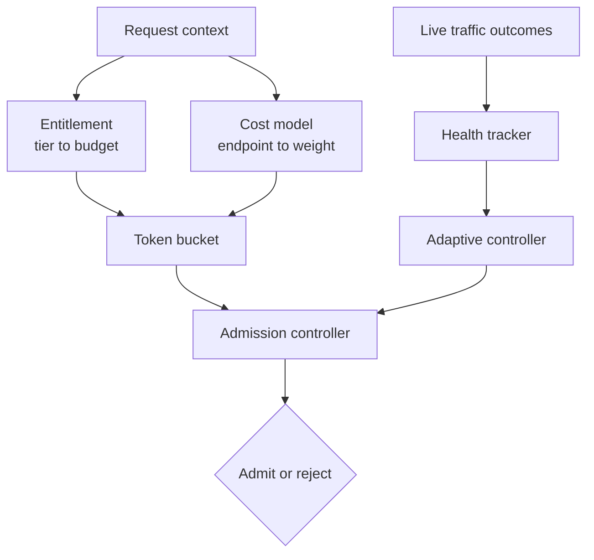

# sluice

Health-aware admission control for Java services.

Most rate limiters only ask "has this client used up their quota?" sluice composes three signals into one decision: who is calling, how expensive the request is, and how healthy the backend is right now.

## How it works



- **Entitlement** maps a client's tier (free / pro / enterprise) to a budget.
- **Cost model** maps an endpoint to a relative weight.
- **Token bucket** consumes cost against budget per client.
- **Health tracker** watches real traffic outcomes (timeouts and 5xx hurt it, 4xx doesn't) in a rolling window.
- **Adaptive controller** derives current backend capacity from health, with bounded recovery so it never snaps back instantly.
- **Admission controller** combines all of the above into one call: `decide(RequestContext)`.

## Status

Early development. Milestone-by-milestone build log in `/docs` (or wherever you're tracking it).

## Build

```
mvn clean install
mvn test
```

## License

MIT